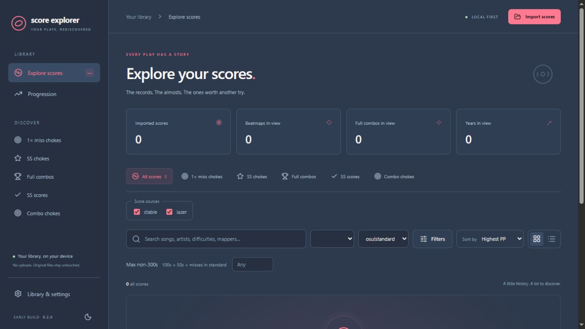

# osu! Score Explorer

Rediscover your osu! scores. Find the plays you're proud of, the chokes worth another try, and the progress you've made along the way.

**[Download for Windows](https://github.com/acrawford0000/osu-score-explorer/releases/latest)** — choose the setup `.exe`, or extract the portable ZIP and launch Score Explorer. Windows x64; no separate Node.js installation is needed.

osu! Score Explorer brings local **stable and lazer scores** into one desktop score browser, with support for **osu!standard, taiko, catch, and mania**. Matching imported copies of a play stay together so they count once in your combined history.

## Explore your scores

- Browse artwork cards or switch to a detailed score table.
- Search by song, artist, difficulty, or mapper.
- Filter by player, gamemode, stable/lazer, mods, date, star rating, and misses.
- Keep a player's stable and lazer scores together across matching usernames and known name changes, with one player option regardless of capitalization.
- Keep both clients selected or explore either history on its own.
- Connect multiple stable and lazer installations, including separate Songs folders.
- Explore an imported score history using beatmaps from your other connected libraries.
- Jump straight to the first or last page, or move ten pages at a time.
- Sort by PP, stars, accuracy, most recent, or potential FC PP gain.
- See achieved combo alongside the map's maximum combo.
- See hit counts on every card to understand exactly how a near-SS play fell short.
- Search and refine your library while results update in the background.

## Save your replays

Export available local **stable and lazer replays** as `.osr` files from score cards or score details. Choose a default export folder in Settings, or let the app ask on your first export and remember your choice. Exporting another copy keeps existing files safe.

## Hear an old favorite again

Open a score and choose **Play song** to listen to its installed beatmap audio from the beginning. Keep browsing with compact sidebar controls, expand them for seeking and volume, or drag a floating player wherever you want within the app.

## Recover missing beatmaps

Enable **automatic beatmap downloads** when importing a score history, or start them later in Settings. Choose a Songs folder and download missing sets **without video**, with progress and pause/resume controls. Matching scores, stars, PP, and FC estimates update as each set finishes.

Download up to three sets at once. The app automatically tries other mirrors when a source is unavailable or rate limits requests.

Use your friend's `osu!.db` to identify maps, or configure osu! API lookup when you only have `scores.db`. Recovery follows your selected player. Older or edited map versions may be unavailable from mirrors; PP is calculated only when the exact version is found.

## Find your next goal

- **One miss chokes:** the plays that came close.
- **SS chokes:** find near-perfect plays and choose your own **Max non-300s** limit. One miss, two 50s, or three 100s can all be worth revisiting.
- **Combo chokes:** zero-miss plays that still fell short of a full combo.
- **Full combos and SS scores:** revisit your achievements.
- **PP if FC:** compare your result with an estimated full-combo result.

Your filters work together, so you can search for something as specific as recent HD one-miss plays above 6 stars, or older SS opportunities with at most three non-300 judgments.

## See your progression

Explore average **star rating, PP, and accuracy** by month or year. Hover or focus a chart point to see its exact average and how many scores contributed to it.

Choose a player and gamemode, narrow the history with your score filters, and compare all attempts with the best result per map and mod combination in each period.

## Make it yours

Keep the original Explorer theme, switch to light mode, or try **Bento, Serika Dark, Nord, Catppuccin, Paper, osu! Web Dark, and Discord Dark**. Your theme, score filters, sort order, and card/table preference are remembered between sessions.

Choose **Lazer 2026 rules** or the previous **rosu-pp** calculator in Settings. Separate saved results let you switch between them without losing earlier calculations. Stars, PP, and PP if FC calculate in the background.

## Project status

This is an early desktop preview under active development. Online replay downloads, opening replays directly in osu!, saved views, retry lists, and more ways to compare attempts are on the [roadmap](TODO.md).

[Development and running from source](docs/development.md)

## Credits

Built with [Tauri](https://tauri.app/) and [Svelte](https://svelte.dev/). Score reading uses [osu-db](https://github.com/kovaxis/osu-db). Calculators use [rosu-pp](https://github.com/MaxOhn/rosu-pp) and the [2026 rules port](https://github.com/Raregendary/rosu-pp-gemini). Concurrent downloads use [osu-downloader](https://github.com/DesireThings/osu-shelf-legacy/tree/main/osu-downloader). Additional color palettes draw from [Monkeytype's themes](https://github.com/monkeytypegame/monkeytype/blob/master/frontend/src/ts/constants/themes.ts).

An independent community project, unaffiliated with the osu! team.

Licensed under [GPL-3.0](LICENSE). See [third party acknowledgements](THIRD_PARTY_NOTICES.md).
